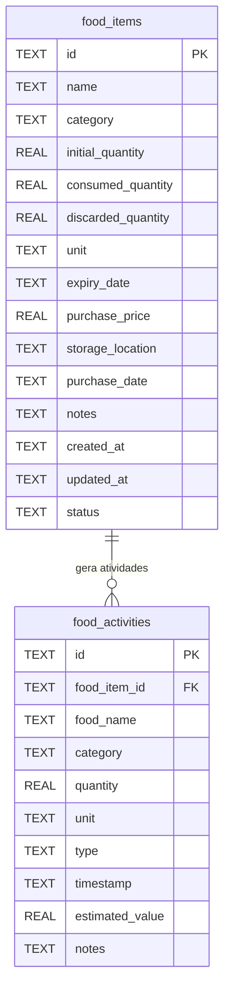

# Valora — Architecture & Technical Specifications

> **Waste less. Live better.**  
> *Não deixe comida boa ir para o lixo.*

Valora é um aplicativo Flutter mobile/desktop/web de gerenciamento de alimentos e prevenção de desperdício com funcionamento 100% offline. Este documento descreve detalhadamente a arquitetura de software, padrão de projeto, esquema de dados, ciclo de vida dos itens e fluxo de dados da aplicação.

---

## 🏗 1. Visão Geral da Arquitetura

O Valora adota uma **Arquitetura em Camadas (Layered Architecture)** com separação clara de responsabilidades entre Apresentação, Estado, Domínio/Dados e Serviços Locais.

```
┌─────────────────────────────────────────────────────────┐
│              Presentation Layer (UI Screens)             │
│   HomeScreen, PantryScreen, ExpiryCenter, Impact, etc.  │
└────────────────────────────┬────────────────────────────┘
                             │ (Consumer / Provider)
┌────────────────────────────▼────────────────────────────┐
│                    State Management                     │
│    PantryProvider   │  ImpactProvider  │ SettingsProvider│
└────────────────────────────┬────────────────────────────┘
                             │ (Calls Services & Repositories)
┌────────────────────────────▼────────────────────────────┐
│                   Data & Service Layer                  │
│   SqliteFoodRepository │ NotificationService │ Prefs    │
└────────────────────────────┬────────────────────────────┘
                             │ (ACID Transactions / Disk)
┌────────────────────────────▼────────────────────────────┐
│                   Local SQLite Database                 │
│         `food_items`    │    `food_activities`          │
└─────────────────────────────────────────────────────────┘
```

### Princípios da Arquitetura:
1. **Offline-First Absoluto**: Toda a persistência ocorre localmente via SQLite (`sqflite` / `sqflite_common_ffi`). Não há backend remoto, endpoints HTTP ou APIs externas.
2. **Reatividade Simplificada com Provider**: Utilização de `ChangeNotifier` para gerenciar estado reativo com performance e transparência.
3. **Internacionalização (i18n)**: Suporte a `pt_BR` e `en` gerado via arquivos ARB fortemente tipados.

---

## 📊 2. Modelo de Dados & Schema SQLite

O repositório do Valora utiliza duas tabelas relacionais fundamentais no SQLite:



### Definição das Tabelas:

#### 1. `food_items`
- **`id`** (`TEXT PRIMARY KEY`): UUID v4 gerado na criação.
- **`name`** (`TEXT NOT NULL`): Nome do alimento (ex: *Leite Integral*).
- **`category`** (`TEXT NOT NULL`): Identificador do enum `FoodCategory`.
- **`initial_quantity`** (`REAL NOT NULL`): Quantidade original cadastrada (> 0).
- **`consumed_quantity`** (`REAL DEFAULT 0.0`): Quantidade acumulada consumida.
- **`discarded_quantity`** (`REAL DEFAULT 0.0`): Quantidade acumulada descartada.
- **`unit`** (`TEXT NOT NULL`): Unidade de medida (`g`, `kg`, `ml`, `l`, `piece`, `pack`, `can`, `unit`).
- **`expiry_date`** (`TEXT`): Data ISO-8601 de validade (`YYYY-MM-DD`). Pode ser nula (validade desconhecida/não informada).
- **`purchase_price`** (`REAL`): Valor de compra opcional (≥ 0).
- **`storage_location`** (`TEXT`): Local de armazenamento (`refrigerator`, `freezer`, `pantry`, `other`).
- **`purchase_date`** (`TEXT`): Data de compra ISO-8601 (`YYYY-MM-DD`).
- **`notes`** (`TEXT`): Observações adicionais do alimento.
- **`created_at`** e **`updated_at`** (`TEXT NOT NULL`): Timestamps ISO-8601.
- **`status`** (`TEXT NOT NULL`): Estado no ciclo de vida (`active`, `consumed`, `discarded`, `archived`).

#### 2. `food_activities`
- **`id`** (`TEXT PRIMARY KEY`): UUID v4 da atividade.
- **`food_item_id`** (`TEXT NOT NULL`): Referência ao item de origem.
- **`food_name`** (`TEXT NOT NULL`): Nome histórico no momento da ação.
- **`category`** (`TEXT NOT NULL`): Categoria do item.
- **`quantity`** (`REAL NOT NULL`): Quantidade registrada nesta ação específica.
- **`unit`** (`TEXT NOT NULL`): Unidade utilizada.
- **`type`** (`TEXT NOT NULL`): Tipo de ação (`consumed` ou `discarded`).
- **`timestamp`** (`TEXT NOT NULL`): Data e hora exata da ação.
- **`estimated_value`** (`REAL`): Valor financeiro estimado proporcional ao preço de compra.
- **`notes`** (`TEXT`): Motivo ou observações do consumo/descarte.

---

## 🔄 3. Ciclo de Vida do Alimento & Status de Validade

### Ciclo de Vida (`FoodLifecycleStatus`)
1. **`active`**: O item possui quantidade remanescente (`initialQuantity - (consumedQuantity + discardedQuantity) > 0`) e está presente na despensa.
2. **`consumed`**: O item teve sua quantidade 100% consumida.
3. **`discarded`**: O item teve sua quantidade remanescente descartada por ter estragado ou vencido.
4. **`archived`**: Item removido visualmente da despensa ativa.

### Regra de Cálculo de Validade (`ExpiryStatus`)
O status de validade é derivado em tempo de execução comparando a data atual (`today`) com `expiryDate` e a margem de aviso configurável (`warningThresholdDays`):

```
                       ┌─────────────────────────┐
                       │ Expiry Date Is Null?    │
                       └───────────┬─────────────┘
                                   │
                         ┌─────────┴─────────┐
                        YES                  NO
                         │                   │
               ┌─────────▼────────┐  ┌───────▼────────────────┐
               │  unknownExpiry   │  │ Compare with Today     │
               └──────────────────┘  └───────┬────────────────┘
                                             │
      ┌──────────────────────┬───────────────┴───────────────┬─────────────────────┐
      │                      │                               │                     │
┌─────▼──────────────┐ ┌─────▼───────────────┐ ┌─────────────▼─────────────┐ ┌─────▼─────────────┐
│ expiryDate < Today │ │ expiryDate == Today │ │ expiryDate <= Today+Days  │ │ expiryDate > Days │
├────────────────────┤ ├─────────────────────┤ ├───────────────────────────┤ ├───────────────────┤
│      expired       │ │    expiringToday    │ │       expiringSoon        │ │       fresh       │
└────────────────────┘ └─────────────────────┘ └───────────────────────────┘ └───────────────────┘
```

> **Garantia de Integridade**: Um item que vence no dia de hoje é classificado como `expiringToday` durante todo o dia civil, nunca sendo considerado `expired` prematuramente antes da meia-noite.

---

## 🛡 4. Transações ACID & Integridade no Consumo/Descarte

As operações de registrar consumo e descarte usam transações SQLite atômicas (`db.transaction`):

```dart
await db.transaction((txn) async {
  // 1. Atualizar quantidades consumidas/descartadas no alimento
  await txn.update(
    'food_items',
    {
      'consumed_quantity': newConsumedQty,
      'discarded_quantity': newDiscardedQty,
      'status': isFullyDepleted ? 'consumed' : 'active',
      'updated_at': DateTime.now().toIso8601String(),
    },
    where: 'id = ?',
    whereArgs: [item.id],
  );

  // 2. Inserir registro de auditoria na tabela de atividades
  await txn.insert('food_activities', activity.toMap());
});
```

Se qualquer erro ocorrer durante a alteração da quantidade ou durante o salvamento da atividade no histórico, a transação é revertida integralmente.

---

## 🔔 5. Notificações Locais

- Gerenciadas via `NotificationService` encapsulado com a lib `flutter_local_notifications`.
- Agendamento contextual para alimentos com data de validade informada.
- Ao atualizar o limiar de alerta ou desativar notificações nas Configurações, todos os alertas pendentes são recalculados ou desagendados via `cancelAll()`.

---

## 🌐 6. Internacionalização (i18n)

- Arquivos fonte em `lib/l10n/app_pt.arb` e `lib/l10n/app_en.arb`.
- Geração automática de classes tipadas em `lib/l10n/generated/app_localizations.dart`.
- Suporte total a plurais, variáveis e termos técnicos localizados em Português do Brasil e Inglês.
